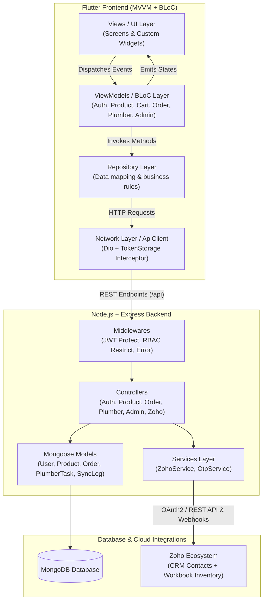
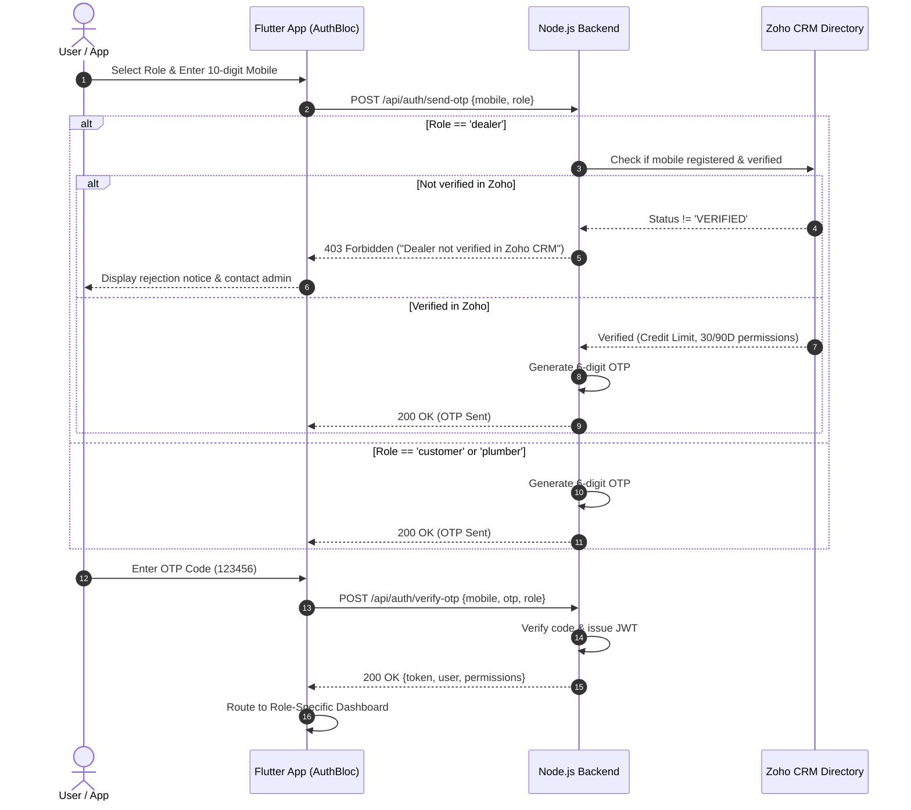

# Mobile App Development – Interview Task: Complete Architecture & Flow Guide

## 1. Executive Summary

This project implements a multi-role commercial commerce platform featuring three dedicated user personas (**Customer**, **Dealer**, **Plumber**) and an **Admin Governance Portal**. 

- **Frontend**: Flutter & Dart using **MVVM (Model-View-ViewModel)** architecture and **BLoC (`flutter_bloc`)** state management.
- **Backend**: Node.js & Express.js with a modular folder structure (`config`, `controllers`, `models`, `routes`, `services`, `middlewares`, `seeds`, `utils`).
- **Database**: MongoDB with Mongoose ORM.
- **Integration**: **Zoho CRM** (Dealer verification & credit terms) and **Zoho Workbook / Sheets** (Product inventory, wholesale/retail pricing, and stock sync).

---

## 2. Architecture & Design Pattern (MVVM + BLoC)



---

## 3. Basic App Flows & Wireframes

### Flow 1: Login & OTP Verification Flow



---

### Flow 2: Customer Purchase Flow

```mermaid
flowchart LR
    L[Login with OTP] --> D[Customer Dashboard]
    D --> C[Categories]
    C --> P[Product Catalog\n(Stock Count Hidden)]
    P --> PD[Product Details]
    PD --> CRT[Add to Cart]
    CRT --> CHK[Checkout]
    CHK --> DP[Direct Payment\n(UPI / Card)]
    DP --> OC[Order Confirmation]
    OC --> OT[Live Order Tracking\n(5-Stage Timeline)]
```

*Wireframe Description:*
- **Catalog View**: Displays product image, title, category, and retail price (₹). Instead of quantity, it shows an `[In Stock]` or `[Out of Stock]` chip.
- **Cart & Checkout**: Real-time GST calculation, address input, and direct payment button.
- **Order Tracking**: Vertical steppers showing:
  1. `Order Placed`
  2. `Confirmed & Packed`
  3. `Dispatched from Warehouse`
  4. `Out for Delivery`
  5. `Delivered`

---

### Flow 3: Dealer Purchase & Credit Flow

```mermaid
flowchart TD
    D1[OTP Login] --> D2[Zoho CRM Verification Check]
    D2 --> D3[Dealer Dashboard\n- Credit Headroom Bar\n- 30D / 90D Status Indicators]
    D3 --> D4[Wholesale Product Catalog\n- Wholesale Dealer Price\n- EXACT Available Warehouse Stock (e.g., 450 units)]
    D4 --> D5[Wholesale Cart / Purchase Order]
    D5 --> D6{Payment Term Selection}
    D6 -->|Option 1| P1[Upfront Direct Payment\n(Cash / RTGS / Instant)]
    D6 -->|Option 2| P2[30-Day Commercial Credit\n(Checks Dealer Credit Limit)]
    D6 -->|Option 3| P3[90-Day Extended Credit\n(Strictly restricted to Tier-1 Approved Dealers)]
    P1 --> D7[PO Confirmed & Logged in Warehouse]
    P2 --> D7
    P3 --> D7
```

*Wireframe Description:*
- **Dealer Header**: Displays "Zoho CRM Verified Partner", Contact ID (`ZC-DL-9081`), and Available Credit line (`₹2,05,000 / ₹2,50,000`).
- **Product Card**: Shows Wholesale Unit Price, MRP strike-through, and explicit badge: `[Stock: 450 units]`.
- **Checkout Radio Term**:
  - `Upfront Payment`
  - `Credit Payment – 30 Days` (Active)
  - `Credit Payment – 90 Days` (Tier-1 Approved pill or Locked badge).

---

### Flow 4: Plumber Flow

```mermaid
flowchart LR
    P_LOG[OTP Login] --> P_DASH[Plumber Dashboard\n- Cert ID & Rating 4.9★\n- Monthly Earnings ₹9,000\n- Availability Toggle]
    P_DASH --> P_ACT[Assigned Field Activities\n(Assigned / In Progress / Completed)]
    P_ACT --> P_UPD[Update Task Status & Notes]
    P_DASH --> P_SUP[Plumbing Supplies Catalog\n(CPVC Solvents, Ball Valves, Traps)]
    P_DASH --> P_NOT[Notifications & Cert Alerts]
```

*Wireframe Description:*
- **Workspace Header**: Displays `[Certified & Verified Plumber]`, Certification ID, and toggle switch for `[Available for New Service Calls]`.
- **Activity Card**: Details customer name, phone number, address, problem description, with actions `[Start Work]` and `[Complete]`.
- **Supplies Requisition**: List of fast-moving items (Solvent cements, Teflon tape, replacement valves).

---

### Flow 5: Admin Functionality

```mermaid
flowchart TD
    A_DASH[Admin Governance Portal] --> A_REP[Executive Business Reports\n- Gross Revenue\n- Upfront Cash vs 30D/90D Credit Exposure]
    A_DASH --> A_USR[User Management\n- Filter Customers, Dealers, Plumbers\n- Plumber Verification Status]
    A_USR --> A_CRD[Dealer Credit Governance\n- Allocate Credit Limit (₹)\n- Toggle 30-Day Credit Permission\n- Toggle 90-Day Credit Permission (Tier-1)]
    A_DASH --> A_ORD[Manage All Commercial Orders\n- View Credit Due Dates\n- Update Shipping Status]
    A_DASH --> A_ZOHO[Zoho Integration Center\n- Manual Trigger 'Sync Zoho Workbook'\n- View Real-Time Ingestion Logs]
```

---

## 4. Key Differences Between Customer and Dealer Access

| Feature / Dimension | Retail Customer | Commercial Dealer |
|---------------------|-----------------|-------------------|
| **Login Requirement** | Any mobile number via OTP | Pre-registered & verified in **Zoho CRM** directory |
| **Pricing Display** | Standard Retail MRP | Discounted Wholesale Dealer Price |
| **Stock Visibility** | **Hidden** (Displays boolean "In Stock" / "Out of Stock") | **Full Transparency** (Exact units in warehouse, e.g. 450 pcs) |
| **Payment Options** | Direct Upfront Payment only (UPI / Card / Netbanking) | 1. Upfront Payment<br>2. 30-Day Credit<br>3. 90-Day Credit (Tier-1 approved) |
| **Credit Facility** | Not Available | Allocated revolving credit limit with tracking |
| **Order Volume** | Retail single-piece quantities | Wholesale lot quantities |
| **Billing Document** | Retail Consumer Invoice | Commercial Tax Invoice / Purchase Order |

---

## 5. Zoho Integration Points

```mermaid
flowchart LR
    subgraph Zoho_Cloud["Zoho Enterprise Services"]
        Z_CRM["Zoho CRM (Vendors & Contacts)"]
        Z_SHEET["Zoho Workbook / Sheets API\n(Product_Inventory_Master)"]
        Z_BOOKS["Zoho Books"]
    end

    subgraph Backend_Sync["Backend Integration Service"]
        Z_SVC["ZohoService.js"]
        AUTH_C["AuthController.js"]
        PROD_C["ProductController.js"]
        ADM_C["AdminController.js"]
        WH_R["Zoho Webhook Receiver"]
    end

    Z_CRM <-->|"Verify Dealer Mobile & Status"| AUTH_C
    Z_SHEET -->|"Ingest SKU, Prices & Stock Quantities"| Z_SVC
    Z_SVC -->|"Store Products"| PROD_C
    WH_R <--|"Triggered on Sheet Edits"| Z_SHEET
    ADM_C -->|"On-Demand Workbook Sync"| Z_SVC
    Z_BOOKS <-->|"Sync Credit Terms (30/90 Days)"| ADM_C
```

1. **Dealer Onboarding & Authentication Gate**:
   - `ZohoService.verifyDealerMobile(mobileNumber)` checks if the dealer is registered in Zoho CRM and marked as `VERIFIED`. Unverified dealers are rejected before OTP generation.
2. **Catalog, Pricing & Stock Synchronization**:
   - `ZohoService.syncWorkbookProducts()` reads rows from the Zoho Workbook (`Product_Inventory_Master`).
   - Sync updates item name, SKU, retail price, wholesale price, and warehouse stock levels in MongoDB.
3. **Webhook Ingestion Endpoint (`/api/zoho/webhook`)**:
   - Listens for automated sheet modification webhooks emitted from Zoho to keep inventory updated without polling.
4. **Credit Terms Synchronization**:
   - Reads approved credit limits and 30-day/90-day eligibility flags configured in Zoho account records.

---

## 6. Pre-Configured Test Accounts for Evaluation

| Persona | Mobile Number | OTP | Credentials & Access Profile |
|---------|---------------|-----|------------------------------|
| **Customer** | `9999900001` | `123456` | Stock quantity hidden, direct payment checkout. |
| **Dealer (Tier 1)** | `9876543210` | `123456` | Zoho Verified (`ZC-DL-9081`), ₹2,50,000 credit, **30-Day & 90-Day Credit Approved**. |
| **Dealer (Tier 2)** | `9876543211` | `123456` | Zoho Verified (`ZC-DL-9082`), ₹1,00,000 credit, **30-Day Credit Only** (90-Day Denied). |
| **Dealer (Unverified)**| `9876543212` | `123456` | **Rejected at OTP Login** (Pending Zoho Documentation). |
| **Plumber** | `9888800001` | `123456` | Verified Certification (`PLM-GOVT-2024-912`), assigned tasks, supplies catalog. |
| **Admin** | `9000000001` | `123456` | Full governance, dealer credit configuration, 30/90D permissions, Zoho sync trigger. |
